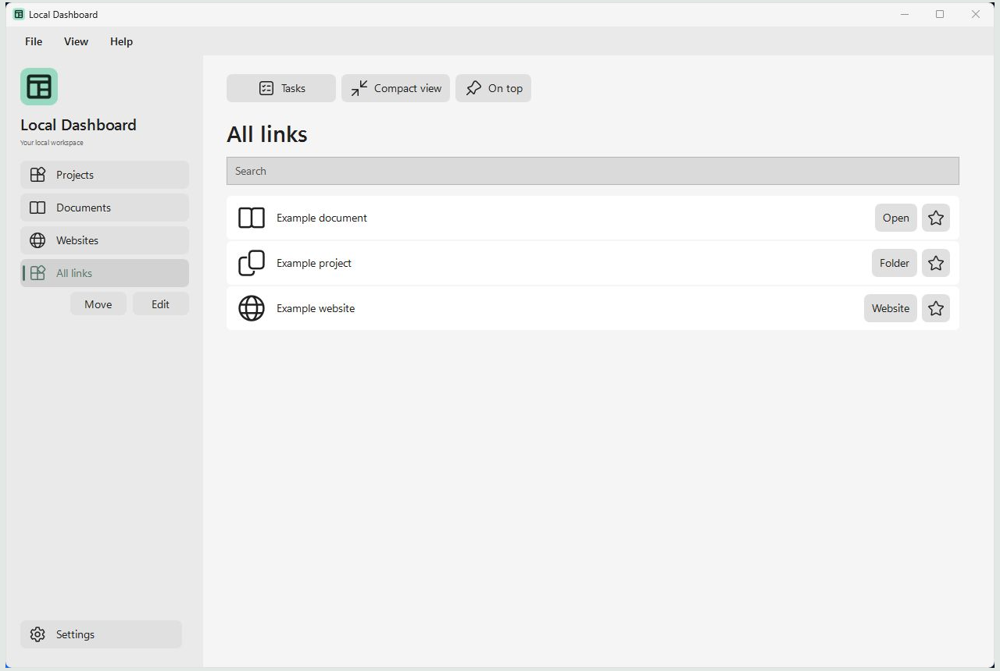
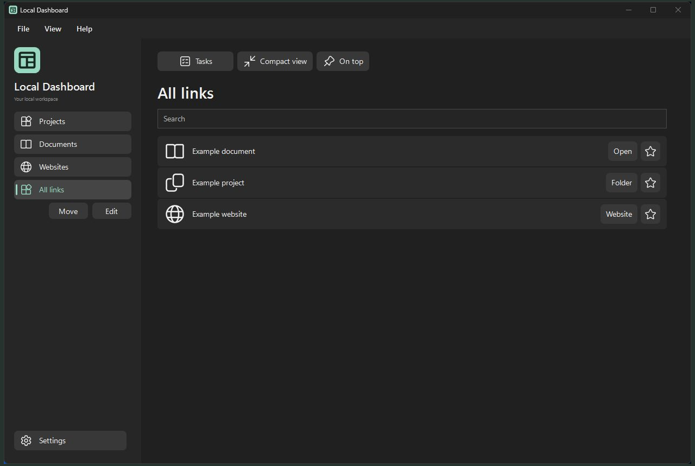

# Local Dashboard


Local Dashboard is a Windows app for opening your project folders, documents and websites, and keeping task lists together in one place.

**Status:** In active development. The latest packaged release for repository members is **2.2.3**.

## Install 2.2.3

Repository access is required for the [v2.2.3 release](https://github.com/DGX-Development/Local-Dashboard/releases/tag/v2.2.3).

- [Windows x64 installer](https://github.com/DGX-Development/Local-Dashboard/releases/download/v2.2.3/LocalDashboard-2.2.3-Setup.exe)
- [Portable ZIP](https://github.com/DGX-Development/Local-Dashboard/releases/download/v2.2.3/LocalDashboard-2.2.3-Portable.zip)
- [SHA-256 checksums](https://github.com/DGX-Development/Local-Dashboard/releases/download/v2.2.3/SHA256SUMS.txt)

1. Close any older Dashboard copy using **File > Exit**, including copies in the system tray.
2. Run Setup. It installs for your Windows account under `%LOCALAPPDATA%\Programs\Local Dashboard` by default. A desktop shortcut is optional.
3. Open **Local Dashboard** from the Start menu and follow the setup walkthrough.

Requirements: Windows 10 22H2 or Windows 11 on x64, with .NET Framework 4.8 or newer. The installer is unsigned. Release files include SHA-256 checksums.

The optional portable ZIP contains an `App` folder. Extract it to a writable folder and run `LocalDashboard.exe`; keep all eight supplied files together. Do not run from inside the ZIP.

For an existing configuration, first use **File > Back up configuration** in your previous copy, then **File > Restore configuration** in the new copy. Review which restored copies Dashboard will use before confirming. Installation does not migrate or reconnect your existing profiles automatically. See the [installation notes](Packaging/INSTALL.txt).

A fresh install shows **Projects**, **Documents**, **Websites** and **All links**, with one generic example in each of the first three categories. Agent tasks and Personal tasks remain unselected until you choose files. Checklists starts empty inside the app's data folder. Existing profiles keep their catalog and saved labels.

## Screenshots

Local Dashboard 2.2.1 showing the same sample workspace in light and dark appearance.

| Light appearance | Dark appearance |
| --- | --- |
| [](Artwork/Exports/Web/local-dashboard-2.2.1-light-1280x860.png) | [](Artwork/Exports/Web/local-dashboard-2.2.1-dark-1280x860.png) |

## What it does

- Opens configured folders, documents and websites from a searchable dashboard.
- Provides **Tasks** with **Agent tasks**, **Personal tasks** and **Checklists**, in that order.
- Shows short task descriptions with longer details collapsed, retaining a full-document view for unfamiliar text formats.
- Keeps Agent tasks read-only; offers explicit editing for Personal tasks and a simple editable checklist.
- Provides compact view, on-top behavior, light/dark appearance, accent colors and window preferences.
- Includes configuration backup/restore, setup, built-in Help and a copyable issue report.

Choose task files in **Settings > Tasks**. Newly selected files load after **Save**. Task views reload on entry. Use **Refresh** beside **Checklists** to reread all three lists. Files in locally synchronized folders work like other local files. Direct Google Drive, Dropbox and OneDrive sign-in is planned. There is no automatic update service.

**Edit Dashboard** opens to the category you are viewing. Add, edit, remove or reorder categories and links in one editor. Drag a row by its grip, or focus the grip and press **Ctrl+Up** or **Ctrl+Down**. Save applies the draft. Use the built-in icon picker or browse for a local image. The setup walkthrough links to an optional AI setup guide.

## Your data

The installed or portable app keeps its catalog in `catalog.json` and its settings and default checklist in `.local/`, beside the executable. Linked task files stay in their selected locations. The installer preserves an existing catalog and `.local/` during upgrades and uninstall.

Configuration backups include Dashboard-owned custom icons and available copies of task lists. Restore reconnects included icons and lets you choose which restored task-list copies to use. Existing files are preserved. Keep a backup before moving or manually changing data.

Version 2.2.0 and later share a single running instance per Windows user. A second launch activates the existing instance. Older, unmodified builds cannot enforce this rule when launched afterward.

## Build from source

The current application is WPF. Use Windows PowerShell or PowerShell 7, the Windows .NET Framework 4.8 compiler, and [Inno Setup](https://jrsoftware.org/isinfo.php). The release installer was built with Inno Setup 7.1.1. No NuGet restore or Node.js dependency is required for this build.

```powershell
& '.\Build-Installer.ps1' -Compiler 'C:\path\to\Inno Setup\ISCC.exe'
```

The script builds the app, creates an exact eight-file payload with a generic starter catalog, and produces Setup, a portable ZIP and checksums under `.dev\Review\Dashboard21\Navigation219\Release223`. It refuses to overwrite an existing payload; use `-OutputDirectory` with a fresh directory under `.dev\Review` for another build. Local profiles, task files and private development notes are excluded.

`Wpf/Build Wpf.ps1` is the explicit-source application build. `Build Dashboard.ps1`, the browser assets and Node scripts remain legacy sources; they are not the 2.2.3 release build path.

## Verification and known limits

The 2.2.3 offscreen checks cover setup, dashboard editing and reordering, task selections, backup handling, and the View menu pin. The light and dark screenshots above show the 2.2.1 baseline. Live pointer dragging and a full accessibility and DPI review remain pending.

See [CHANGELOG.md](CHANGELOG.md) for the release changes. Use **Help > Help and user guide** for everyday use, or **Help > Report an issue** to copy a report for [DGX Development support](https://dgx.digitalguy.me/contact.html).

## Rights and attribution

No open-source license for the application or DGX artwork is granted by this repository. Interface icons come from [Microsoft Fluent System Icons](https://github.com/microsoft/fluentui-system-icons), with the original [LICENSE](Artwork/Icons/fluent/LICENSE), [NOTICE](Artwork/Icons/fluent/NOTICE) and pinned [asset manifest](Artwork/Icons/fluent/manifest.json) retained. The installer is built with Inno Setup.
