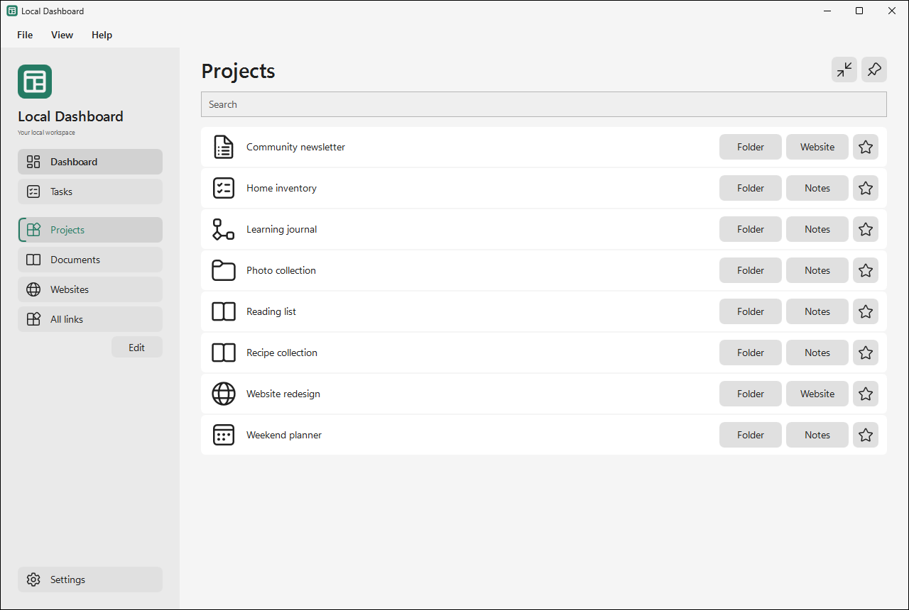
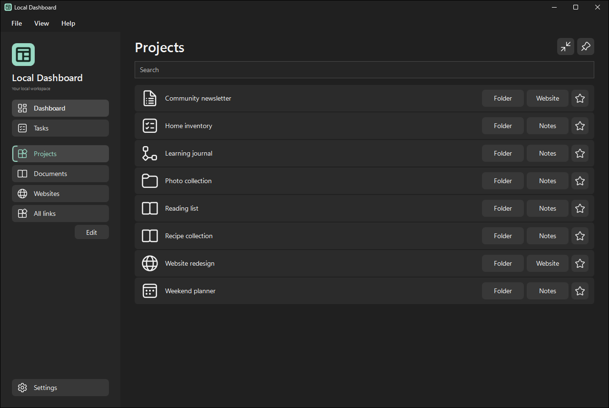

# Local Dashboard


Local Dashboard is a Windows app for opening your project folders, documents and websites, and keeping task lists together in one place.

**Status:** In active development. The latest packaged release is **3.0.1**.

## Install 3.0.1

See the [v3.0.1 release](https://github.com/DGX-Development/Local-Dashboard/releases/tag/v3.0.1).

- [Windows x64 installer](https://github.com/DGX-Development/Local-Dashboard/releases/download/v3.0.1/LocalDashboard-3.0.1-Setup.exe)
- [Portable ZIP](https://github.com/DGX-Development/Local-Dashboard/releases/download/v3.0.1/LocalDashboard-3.0.1-Portable.zip)
- [SHA-256 checksums](https://github.com/DGX-Development/Local-Dashboard/releases/download/v3.0.1/SHA256SUMS.txt)

1. Close any older Dashboard copy using **File > Exit**, including copies in the system tray.
2. Run Setup. It installs for your Windows account under `%LOCALAPPDATA%\Programs\Local Dashboard` by default. A desktop shortcut is optional.
3. Open **Local Dashboard** from the Start menu and follow the setup walkthrough.

Requirements: Windows 10 22H2 or Windows 11 on x64, with the .NET 10 runtime included in the self-contained download. The installer is unsigned. Release files include SHA-256 checksums.

The optional portable ZIP contains an `App` folder. Extract it to a writable folder and run `LocalDashboard.exe`; keep all ten supplied files together. Do not run from inside the ZIP.

For an existing configuration, first use **File > Back up configuration** in your previous copy, then choose **Restore from a backup** on the welcome screen of the new copy or **File > Restore configuration** in Dashboard. Review which restored copies Dashboard will use before confirming. An upgrade in the same folder keeps its existing configuration. For an existing 2.2.7 or 3.0.x portable folder, fully exit Dashboard and replace only `LocalDashboard.exe` from the new package; retain `catalog.json`, `.local`, custom icons and linked files. See the [installation notes](Packaging/INSTALL.txt).

A fresh 3.0.1 release starts with empty **Projects**, **Documents**, **Websites** and **All links** categories, ready for your backup or your own links. Generic files in the supplied Examples folder can be selected manually. Task list 1 is visible. Choosing files for Task list 2 and Task list 3 adds their tabs. Checklists starts empty inside the app's data folder. Existing profiles keep their catalog and saved labels.

## Screenshots

Local Dashboard 3.0.1 showing the same sample projects in light and dark appearance. Examples include folders, notes, and website links.

| Light appearance | Dark appearance |
| --- | --- |
| [](Artwork/Exports/Web/local-dashboard-3.0.1-light-1280x860.png) | [](Artwork/Exports/Web/local-dashboard-3.0.1-dark-1280x860.png) |

## What it does

- Opens configured folders, documents and websites from a searchable dashboard.
- Provides **Tasks** with up to three editable text lists and **Checklists**.
- Shows short task descriptions with longer details collapsed, retaining a full-document view for unfamiliar text formats.
- Use **Edit** below the Tasks sidebar to add, edit, or remove items and edit whole task documents. Checklists autosaves to its selected file.
- Provides compact view, on-top behavior, light/dark appearance, accent colors and window preferences.
- Includes configuration backup/restore, setup, built-in Help and a confirmation before opening the public GitHub issue page.

Choose an existing file or create a task file in **Settings > Tasks**. Newly selected files load after **Save**. Task views reload on entry. Use **Refresh** beside Search to reread the current list. Files in locally synchronized folders work like other local files. Use **Help > Check for updates** to find the latest stable release on GitHub.

**Edit Dashboard** opens to the category you are viewing. Add, edit, remove or reorder categories and links in one editor. Drag a row by its grip, or focus the grip and press **Ctrl+Up** or **Ctrl+Down**. Save applies the draft. Use the built-in icon picker or browse for a local image. Show or hide **All links** in **Settings > Appearance**.

## Your data

The installed or portable app keeps its catalog in `catalog.json` and its settings and default checklist in `.local/`, beside the executable. Linked task files stay in their selected locations. Upgrades keep your settings and data. Uninstall lets you keep or remove settings, links and favorites. Task files and checklist data stay in place.

Configuration backups include readable custom icon files and available copies of task lists. Restore reconnects included icons and lets you choose which restored task-list copies to use. Existing files are preserved. Keep a backup before moving or manually changing data.

Version 2.2.0 and later share a single running instance per Windows user. A second launch activates the existing instance. Older, unmodified builds cannot enforce this rule when launched afterward.

## Build from source

The current application is WPF. Use Windows PowerShell or PowerShell 7, the .NET 10 SDK, the Windows .NET Framework compiler for the existing icon exporter, and [Inno Setup](https://jrsoftware.org/isinfo.php). The release installer was built with Inno Setup 7.1.1. The SDK restores Windows runtime/reference packs when needed. Node.js is not required.

```powershell
& '.\Build-Installer.ps1' -Compiler 'C:\path\to\Inno Setup\ISCC.exe' -BlankProfile
```

The script builds the app, creates an exact ten-file payload with an empty catalog, and produces Setup, a portable ZIP and checksums under `.dev\Review\Net10\Installer`. It refuses to overwrite an existing payload; use `-OutputDirectory` with a fresh directory under `.dev\Review` for another build. Local profiles, task files and private development notes are excluded.

`Wpf/Build Wpf.ps1` is the explicit-source application build. `Build Dashboard.ps1`, the browser assets and Node scripts remain legacy sources; they are not the 3.0.1 release build path.

## Verification and known limits

The automated suites cover setup, dashboard editing, task refresh, backup/restore with embedded custom icons, website icon selection, shared controls and compact layout. Full accessibility and DPI coverage remain incomplete. Rapid accent changes can leave the taskbar icon one color behind; pause between selections to let it refresh.

See [CHANGELOG.md](CHANGELOG.md) for the release changes. Use **Help > Help and user guide** for everyday use, or **Help > Report an issue** to see a notice before opening the [public GitHub issue page](https://github.com/DGX-Development/Local-Dashboard/issues/new). A GitHub account is required to submit an issue. Include the app version, Windows version and reproduction steps; do not post private task contents, personal paths, credentials or backups. Nothing is submitted automatically.

## Rights and attribution

No open-source license for the application or DGX artwork is granted by this repository. Interface icons come from [Microsoft Fluent System Icons](https://github.com/microsoft/fluentui-system-icons), with the original [LICENSE](Artwork/Icons/fluent/LICENSE), [NOTICE](Artwork/Icons/fluent/NOTICE) and pinned [asset manifest](Artwork/Icons/fluent/manifest.json) retained. The installer is built with Inno Setup.
