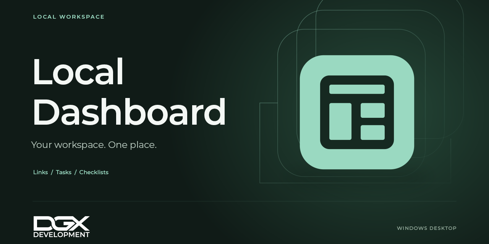

# Local Dashboard



Local Dashboard is a Windows app for opening your project folders, documents and websites, and keeping task lists together in one place.

## Install 2.2.0

Download **LocalDashboard-2.2.0-Setup.exe** from the [2.2.0 release](https://github.com/DGX-Development/Local-Dashboard/releases/tag/v2.2.0). This repository is private, so downloads require an account with access.

1. Close any older Dashboard copy using **File > Exit**, including copies in the system tray.
2. Run Setup. It installs for your Windows account under `%LOCALAPPDATA%\Programs\Local Dashboard` by default. A desktop shortcut is optional.
3. Open **Local Dashboard** from the Start menu and follow the setup walkthrough.

Requirements: Windows 10 22H2 or Windows 11 on x64, with .NET Framework 4.8 or newer. The installer is unsigned. Release files include SHA-256 checksums.

The optional portable ZIP contains an `App` folder. Extract it to a writable folder and run `LocalDashboard.exe`; keep all six supplied files together. Do not run from inside the ZIP.

For an existing configuration, first use **File > Back up configuration** in your previous copy, then **File > Restore configuration** in the new copy. Review the task-list restore option before choosing it. Installation does not migrate or reconnect your existing profiles automatically. See the [installation notes](Packaging/INSTALL.txt).

## What it does

- Opens configured folders, documents and websites from a searchable dashboard.
- Provides **Tasks** with **Agent tasks**, **Personal tasks** and **Checklists**, in that order.
- Shows short task descriptions with longer details collapsed, retaining a full-document view for unfamiliar text formats.
- Keeps Agent tasks read-only; offers explicit editing for Personal tasks and a simple editable checklist.
- Provides compact view, on-top behavior, light/dark appearance, accent colors and window preferences.
- Includes configuration backup/restore, setup, built-in Help and a copyable issue report.

Choose task files in **Settings > Tasks**. A local file in a folder already synchronized by another service works like any local file. Direct Google Drive, Dropbox and OneDrive sign-in is **coming soon**. There is no automatic update service.

New dashboard entries can be configured in `catalog.json`; **Edit dashboard links** edits existing entries and destinations. The setup walkthrough explains the dashboard but does not create new catalog entries for you.

## Your data

The installed or portable app keeps its catalog in `catalog.json` and its settings and default checklist in `.local/`, beside the executable. Linked task files stay in their selected locations. The installer preserves an existing catalog and `.local/` during upgrades and uninstall.

Configuration backups can carry copies of task lists. Restore keeps linked documents safe by using the explicit restore choices rather than silently overwriting originals. Keep a backup before moving or manually changing data.

Version 2.2.0 and later share a single running instance per Windows user. A second launch activates the existing instance. Older, unmodified builds cannot enforce this rule when launched afterward.

## Build from source

The current application is WPF. Use Windows PowerShell or PowerShell 7, the Windows .NET Framework 4.8 compiler, and [Inno Setup](https://jrsoftware.org/isinfo.php). The release installer was built with Inno Setup 7.1.1. No NuGet restore or Node.js dependency is required for this build.

```powershell
& '.\Build-Installer.ps1' -Compiler 'C:\path\to\Inno Setup\ISCC.exe'
```

The script builds the app, creates an exact six-file payload with a generic starter catalog, and produces Setup, a portable ZIP and checksums under `.dev\Review\Dashboard21\Navigation219\Release220`. It refuses to overwrite an existing payload; use `-OutputDirectory` with a fresh directory under `.dev\Review` for another build. Local profiles, task files and private development notes are excluded.

`Wpf/Build Wpf.ps1` is the explicit-source application build. `Build Dashboard.ps1`, the browser assets and Node scripts remain legacy sources; they are not the 2.2.0 release build path.

## Verification and known limits

Focused checks covered the task presentation, editing behavior, editor initial selection, shared controls, menus, About and separate-process instance guard. The packaged app's read diagnostic passed after silent installation. Installation, an in-place upgrade and uninstall were checked with disposable data; the catalog and `.local/` survived both upgrade and uninstall. A full accessibility/DPI matrix and the interactive installer wizard were not tested for this release.

See [CHANGELOG.md](CHANGELOG.md) for the release changes. Use **Help > Help and user guide** for everyday use, or **Help > Report an issue** to copy a report for [DGX Development support](https://dgx.digitalguy.me/contact.html).

## Rights and attribution

No open-source license for the application or DGX artwork is granted by this repository. Interface icons come from [Microsoft Fluent System Icons](https://github.com/microsoft/fluentui-system-icons), with the original [LICENSE](Artwork/Icons/fluent/LICENSE), [NOTICE](Artwork/Icons/fluent/NOTICE) and pinned [asset manifest](Artwork/Icons/fluent/manifest.json) retained. The installer is built with Inno Setup.
